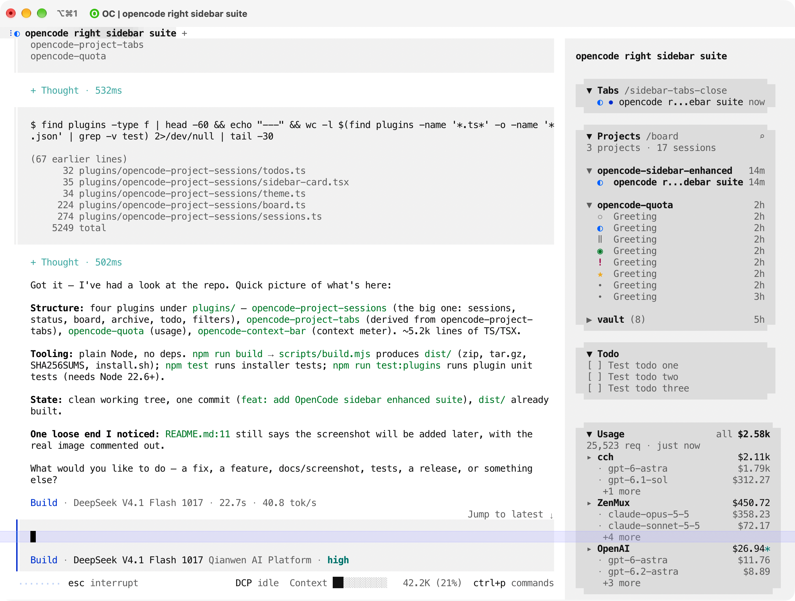
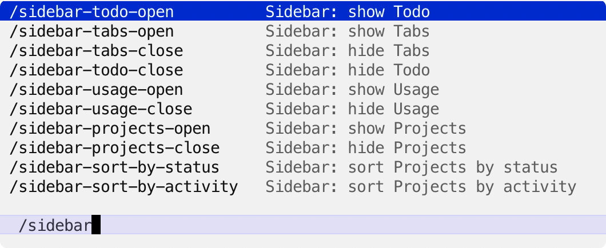
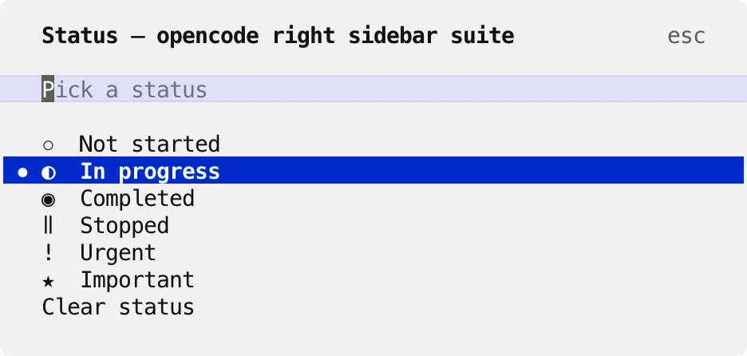
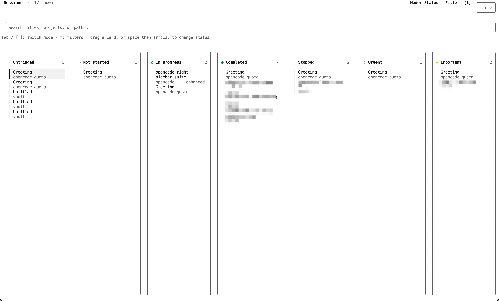
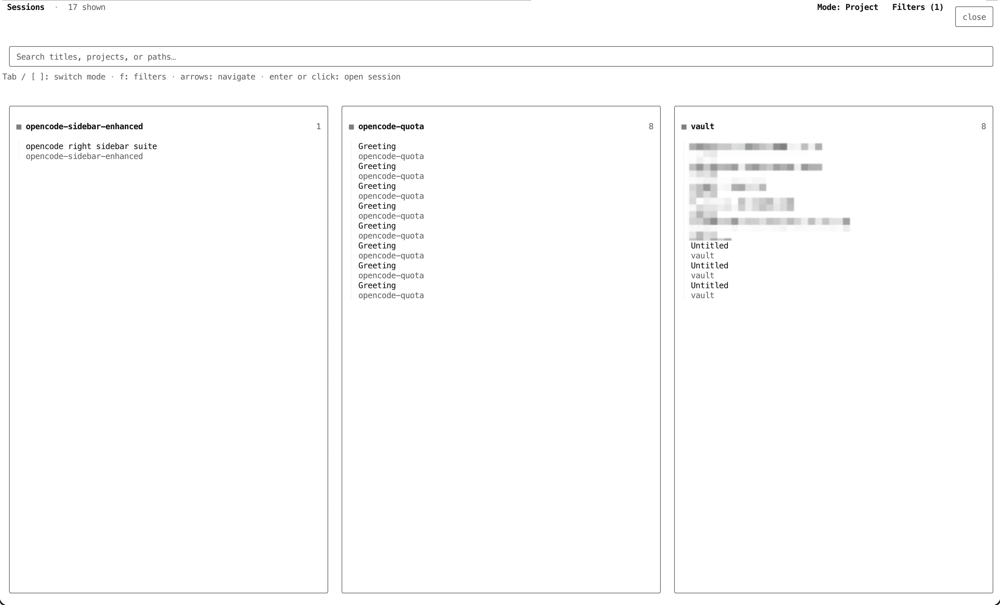
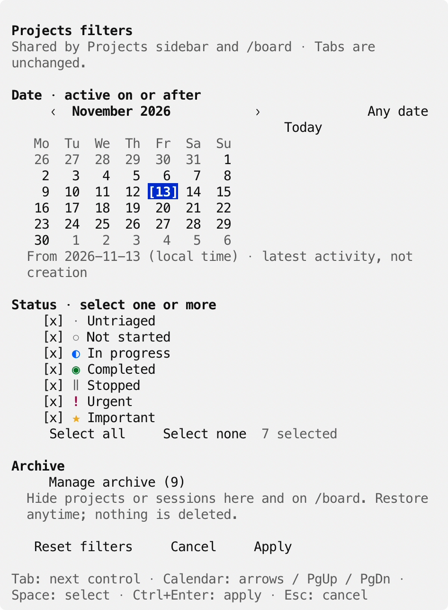
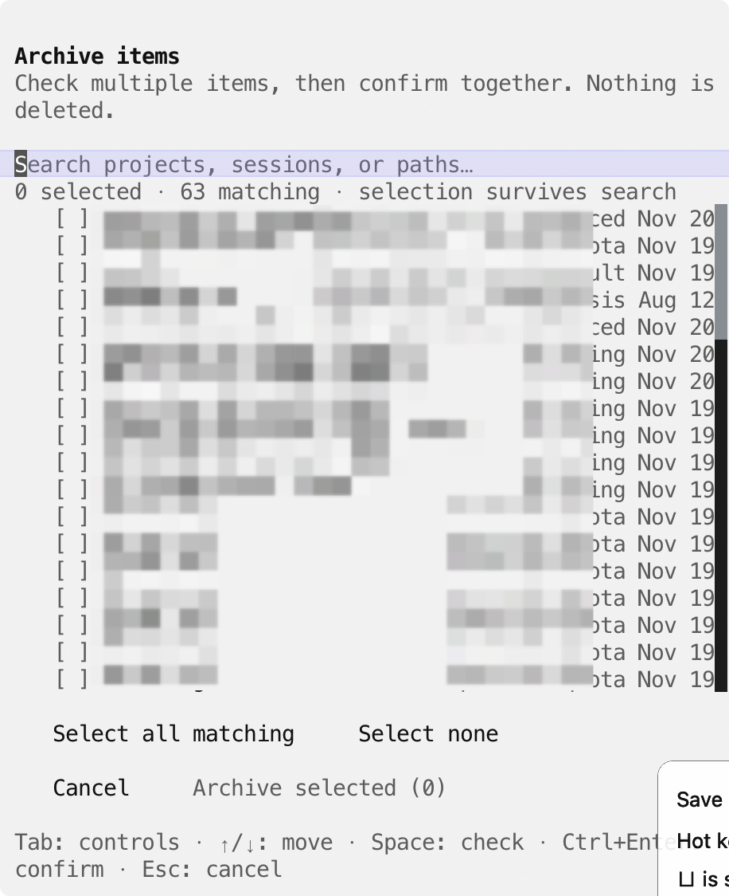
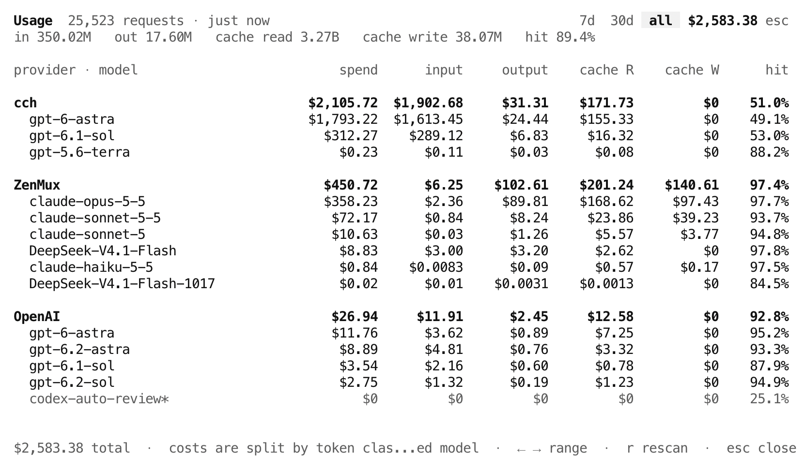

# OpenCode Sidebar Enhanced

**English** | [简体中文](README.zh-CN.md)

A theme-aware sidebar and session-management toolkit for **OpenCode V2**.
Browse projects and sessions, assign task statuses, organize work on a kanban board,
archive in batches, and keep usage and context information in view.

## Screenshots



> The full suite in the OpenCode TUI: Tabs, Projects, Todo, and Usage cards on the right sidebar.



> `/sidebar-*` commands show/hide each card and switch Projects sorting.



> `/session-status` assigns one of six task statuses to the current session.



> `/board` in **Status mode:** a kanban of sessions across status columns, with drag-and-drop.



> `/board` in **Project mode**: the same sessions grouped by project.



> `/sidebar-projects-filter`: calendar date filter and multi-select statuses, shared by Projects and Board.



> `/archive`: search, check multiple projects/sessions, and confirm in one batch — nothing is deleted.



> `/quota`: full-screen cost estimates by provider and model, with token and cache-hit details.

## Features

- **Tabs:** compact sidebar list, task-status icons, and a close-command hint.
- **Projects:** sessions across projects, collapsible groups, activity or status sorting.
- **Task statuses:** ○ Not started, ◐ In progress, ◉ Completed, ‖ Stopped, ! Urgent, ★ Important.
  Statuses are independent of agent execution and are saved by immutable session ID.
- **Board:** full-screen Status / Project views, drag-and-drop status changes, and keyboard navigation.
- **Shared filters:** click-to-select calendar and multiple statuses; apply to Projects and Board, not Tabs.
- **Archive and restore:** searchable, multi-select project/session lists with explicit batch confirmation.
  Nothing is deleted, no agent is stopped, and no tab is closed.
- **Todo:** current session tasks. 
- **Usage:** local Qoder, Codex, and Claude Code usage estimates by provider/model, plus a full-screen breakdown.
- **Context meter:** a labeled progress bar beneath the prompt, alongside compatible footer plugins such as DCP.

## Install

### Requirements

- **OpenCode V2 2.2.5 or newer**.
- **Node.js 20+ or Bun** for the installer.
- macOS or Linux. Windows is not currently supported by the installer.

### Option 1: download the release — recommended

1. Open [Releases](https://github.com/yifu-ding/opencode-sidebar-enhanced/releases/latest).
2. Download **`opencode-sidebar-enhanced-v0.1.0.zip`** or the `.tar.gz` asset. Do not choose GitHub's automatic “Source code” archive for this installation method.
3. Extract it.
4. On **macOS**, double-click **`Install.command`**. On macOS/Linux, you can instead open a terminal in the extracted folder and run:

   ```sh
   bash install.sh
   ```

5. In OpenCode, run **`/reload`**. No service restart is needed.

If macOS blocks a downloaded script, inspect it first and use `bash install.sh` in Terminal.
Do not disable system security protections. No API key or `npm install` is needed.

### Option 2: build from this repository

```sh
git clone https://github.com/yifu-ding/opencode-sidebar-enhanced.git
cd opencode-sidebar-enhanced
npm run build
bash dist/install.sh
```

Building requires `tar` and `zip` on PATH. All plugin sources are included in this repository;
no sibling repositories or author-specific paths are needed. Then run `/reload` in OpenCode.

### What the installer changes

- Backs up `~/.config/opencode/cli.json`, then merges the four plugin entries.
- Preserves unrelated plugins, theme, keybindings, and other configuration values.
- Replaces older standalone copies of these same plugins to prevent duplicate UI.
- Disables the native Context, Todo, and Footer contributions to prevent duplicates.
- Installs a separate version directory under `~/.local/share/opencode-sidebar-enhanced`.
- Does **not** copy or reset your sessions, statuses, archives, or credentials.

`XDG_CONFIG_HOME` and `XDG_DATA_HOME` are respected. JSONC comments and trailing commas
are accepted; the merged file is written as JSON, while the backup retains the original formatting.

```sh
bash install.sh --dry-run
bash install.sh --config /path/to/cli.json --destination /path/to/plugins
```

## Commands

| Command | Action |
| --- | --- |
| `/board` | Open the full-screen sessions board |
| `/sessions` | Search and open sessions |
| `/session-status` | Assign or clear a task status |
| `/sidebar-projects-filter` | Calendar, status filters, and archive management |
| `/archive` | Open the multi-select archive dialog directly |
| `/restore-archive` | Open the multi-select restore dialog directly |
| `/sidebar-tabs-open` / `/sidebar-tabs-close` | Show / hide the Tabs card |
| `/sidebar-projects-open` / `/sidebar-projects-close` | Show / hide the Projects card |
| `/sidebar-todo-open` / `/sidebar-todo-close` | Show / hide the Todo card |
| `/sidebar-usage-open` / `/sidebar-usage-close` | Show / hide the Usage card |
| `/sidebar-sort-by-status` | Sort by Urgent → Important → In progress → Not started → Completed → other statuses → unassigned |
| `/sidebar-sort-by-activity` | Sort by recent activity |
| `/quota` | Open the usage breakdown |

Click a visible card's header to fold its contents. The `close` commands hide the entire card;
the `open` commands show and unfold it.

### Keyboard and filtering

- **Board:** `Tab` switches Status / Project mode; `f` opens filters; Space picks up/drops a card;
  arrow keys or `hjkl` move; Enter opens a session; Esc closes the board.
- **Calendar:** arrow keys move by day/week, PgUp/PgDn change month, Space selects a date.
  The date is inclusive and uses the session's latest activity in local time, not creation time.
- **Filters:** Apply / Ctrl+Enter commits; Cancel / Esc leaves the live filters unchanged.
- **Archive:** search, check multiple items, then confirm Archive selected / Restore selected.
  Selections survive searching. Cancel does not commit changes.

Archiving a project hides its sessions from Projects and Board. Restoring that project does
not restore sessions that were also individually archived. Reset filters does not clear archives.

## Update and uninstall

To update, download a new release and run its installer. Previous version directories are kept.
To uninstall, double-click `Uninstall.command` on macOS, or run:

```sh
bash install.sh --uninstall
```

Use the same `--config` / `--destination` arguments if you customized installation.
Uninstall removes this installation's plugin entries, restores displaced standalone entries,
and undoes only native-plugin disables introduced by this installer. Later unrelated config changes
are preserved. Plugin files and session/status/archive data are kept. Run `/reload` afterwards.

## Privacy and limitations

- Release assets contain code, documentation, licenses, and installers — **not the author's
  conversations, statuses, archives, provider settings, credentials, or usage cache**.
- The installer makes no network requests and uploads nothing. Projects uses your currently
  connected OpenCode service; Usage reads local transcript usage, provider names, and price tables.
- Usage is a local cost estimate, **not an account balance or authoritative provider bill**.
  Tools without local usage records contribute no data.
- Native horizontal-tab icons use a compatibility adapter because there is no public title slot.
  Ambiguous duplicate titles or unknown layouts are skipped rather than assigned an incorrect status.
- This is a local TUI suite; it does not change the OpenCode web/desktop UI.

## Development

```sh
npm run build       # ZIP, tar.gz, SHA256SUMS, and dist/install.sh
npm test            # Installer unit/integration tests; build first
npm run test:plugins # Plugin unit tests; Node.js 22.6+ required
```

No dependency installation is required for building or these tests. Runtime peer dependencies are supplied by OpenCode. 

## License and credits

[MIT](LICENSE). The Tabs module is derived from
[opencode-project-tabs](https://github.com/cnicolov/opencode-project-tabs) by Kristiyan Nikolov.
Its original license is preserved. See [third-party notices](THIRD_PARTY_NOTICES.md).
