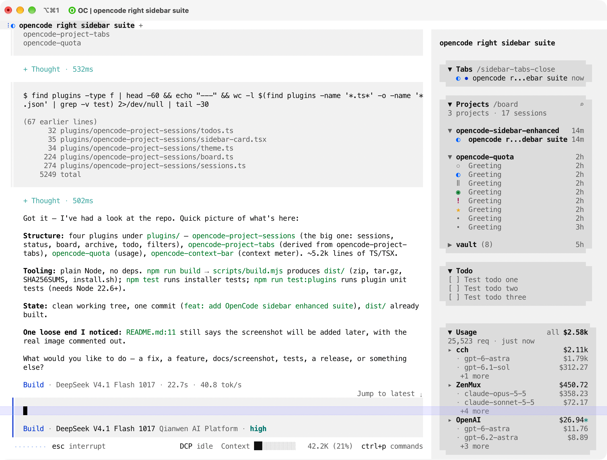
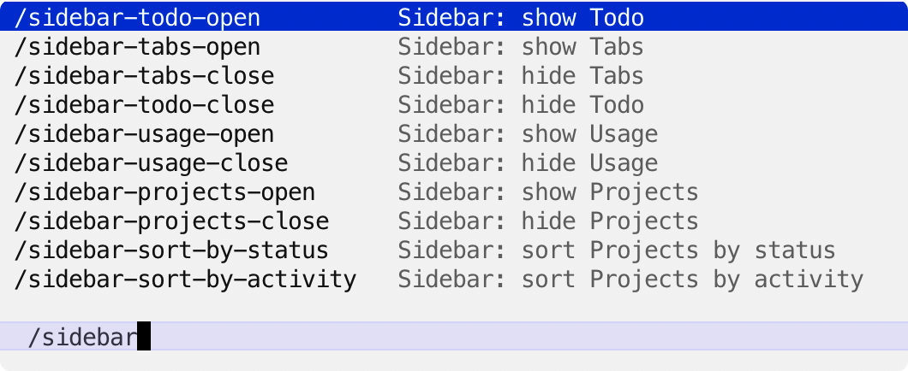
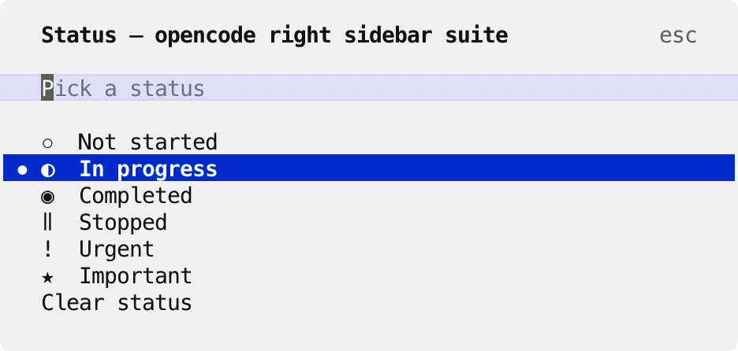
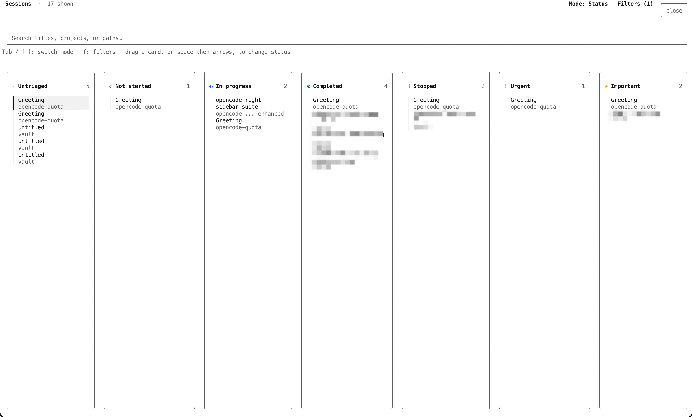
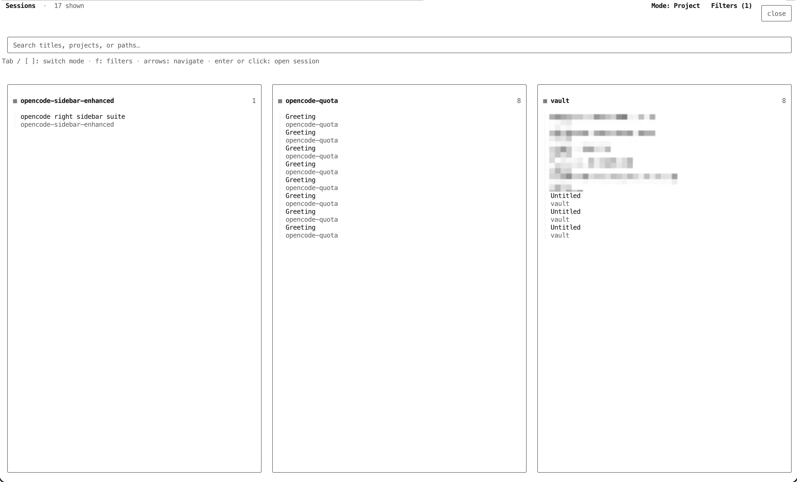
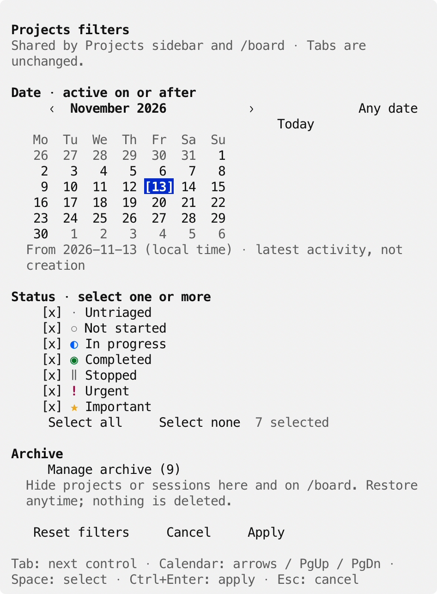
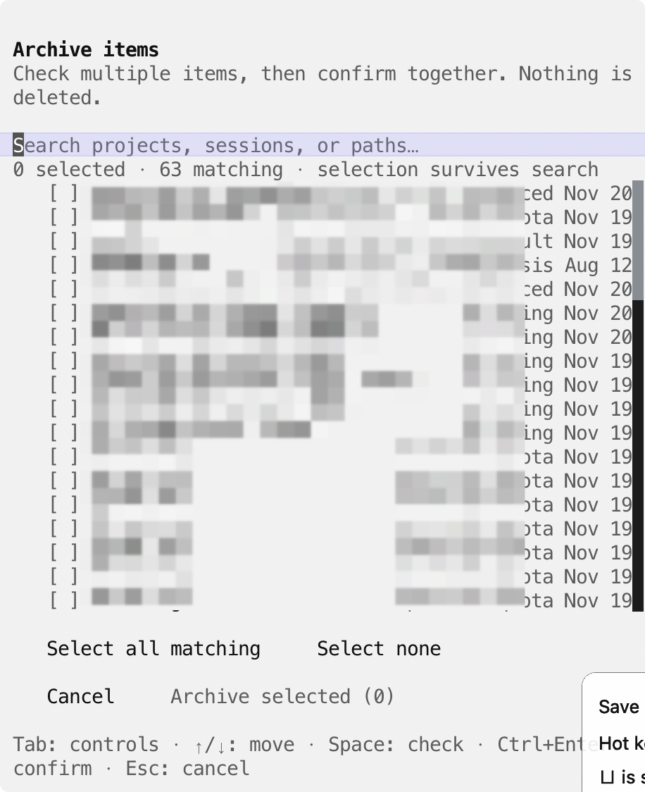
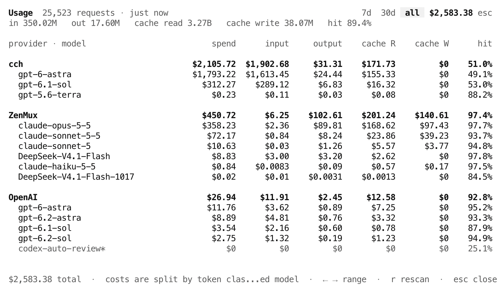

# OpenCode Sidebar Enhanced

[English](README.md) | **简体中文**

面向 **OpenCode V2** 的侧边栏与会话管理套件：项目会话、手动任务状态、全屏看板、
多选归档与恢复、Todo、费用估算，以及输入框下方的 Context 进度条。

## 截图



> OpenCode TUI 中的完整套件：右侧边栏的 Tabs、Projects、Todo、Usage 卡片。



> `/sidebar-*` 命令控制各卡片的显示/隐藏，以及 Projects 的排序方式。



> `/session-status` 为当前会话设置六种任务状态之一。



> `/board` 的 Status 模式：按状态分列的会话看板，支持拖拽改状态。



> `/board` 的 Project 模式：同一批会话按项目分组展示。



> `/sidebar-projects-filter`：日历选日期、Status 多选，同步作用于 Projects 与 Board。



> `/archive`：搜索、多选项目/会话后批量确认归档，不删除任何记录。



> `/quota`：按供应商和模型的全屏费用估算，含 token 与缓存命中率明细。

## 功能

- **Tabs**：紧凑的侧边栏列表、任务状态图标、关闭命令提示。
- **Projects**：跨项目浏览会话、折叠项目、按状态或最近活动排序。
- **Status**：○ 未开始、◐ 进行中、◉ 已完成、‖ 暂停、! 紧急、★ 重要。
    与 agent 运行状态分开，按 session ID 保存，修改标题不会丢失。
- **Board**：Status / Project 双模式全屏看板，鼠标拖拽或键盘修改状态。
- **筛选**：点击日历选日期、Status 多选；同步作用于 Projects 与 Board，不筛选 Tabs。
- **归档与恢复**：Project / Session 搜索、多选、批量确认，不删除记录、不停止 agent、不关闭 tabs。
- **Todo**：显示当前会话的任务，尊重消息回退。
- **Usage**：读取本地 Qoder / Codex / Claude Code 用量，按供应商和模型估算费用，可打开全屏明细。
- **Context**：输入框下方的上下文进度条，可以与 DCP 等 footer 插件共存。

## 安装

### 环境要求

- **OpenCode V2 2.2.5 或更新版本**。
- 安装器需要 **Node.js 20+ 或 Bun**。
- 支持 macOS / Linux；安装器暂不支持 Windows。

### 方式一：下载分发包（推荐）

1. 打开 [Releases](https://github.com/yifu-ding/opencode-sidebar-enhanced/releases/latest)。

2. 下载 **`opencode-sidebar-enhanced-v0.1.0.zip`** 或 `.tar.gz` 附件。
    此方式不要选择 GitHub 自动生成的 “Source code” 压缩包。

3. 解压。

4. **macOS：双击 `Install.command`**。macOS / Linux 也可以在解压目录执行：

    ```sh
    bash install.sh
    ```

5. 在 OpenCode 输入 **`/reload`**，无需重启服务。

如果 macOS 阻止打开下载的脚本，请先查看内容，再从终端执行 `bash install.sh`。
不要关闭系统安全保护。安装无需 API Key，也无需 `npm install`。

### 方式二：从本仓库构建

```sh
git clone https://github.com/yifu-ding/opencode-sidebar-enhanced.git
cd opencode-sidebar-enhanced
npm run build
bash dist/install.sh
```

构建需要系统提供 `tar` 和 `zip`。四个插件的源码均包含在本仓库中，
不依赖其他本地仓库或作者电脑路径。安装后在 OpenCode 输入 `/reload`。

### 安装器如何处理配置

- 先备份 `~/.config/opencode/cli.json`，再合并四个插件项。
- 保留主题、快捷键及其他设置和无关插件。
- 替换同名旧独立插件的加载路径，避免重复显示。
- 停用原生 Context / Todo / Footer 贡献，避免与套件重复。
- 每次安装在 `~/.local/share/opencode-sidebar-enhanced` 下建立独立版本目录，不覆盖旧版本。
- **不会复制或重置你的会话、状态、归档或认证信息。**

遵循 `XDG_CONFIG_HOME` / `XDG_DATA_HOME`。支持读取 JSONC 注释及尾逗号；合并后写为标准 JSON，
备份保留原始文本格式。可先预览，或指定目标路径：

```sh
bash install.sh --dry-run
bash install.sh --config /path/to/cli.json --destination /path/to/plugins
```

## 命令

| 命令                                                 | 功能                                                        |
| ---------------------------------------------------- | ----------------------------------------------------------- |
| `/board`                                             | 全屏会话看板                                                |
| `/sessions`                                          | 搜索并打开会话                                              |
| `/session-status`                                    | 设置或清除任务状态                                          |
| `/sidebar-projects-filter`                           | 日历、Status 筛选及归档管理                                 |
| `/archive`                                           | 直接打开多选归档对话框                                      |
| `/restore-archive`                                   | 直接打开多选恢复对话框                                      |
| `/sidebar-tabs-open` / `/sidebar-tabs-close`         | 显示 / 隐藏 Tabs                                            |
| `/sidebar-projects-open` / `/sidebar-projects-close` | 显示 / 隐藏 Projects                                        |
| `/sidebar-todo-open` / `/sidebar-todo-close`         | 显示 / 隐藏 Todo                                            |
| `/sidebar-usage-open` / `/sidebar-usage-close`       | 显示 / 隐藏 Usage                                           |
| `/sidebar-sort-by-status`                            | ! → ★ → 进行中 → 未开始（Todo）→ 已完成 → 其他状态 → 无状态 |
| `/sidebar-sort-by-activity`                          | 按最近活动排序                                              |
| `/quota`                                             | 全屏费用明细                                                |

点击卡片标题只折叠内容；`close` 隐藏整个卡片，`open` 显示并展开卡片。

### 键盘与筛选

- 看板：`Tab` 切换模式，`f` 打开筛选，Space 拾起/放下卡片，方向键或 `hjkl` 移动，Enter 打开，Esc 关闭。
- 日历：方向键按天/周移动，PgUp / PgDn 切换月份，Space 选择日期。
    日期依据会话的最近活动而不是创建时间，采用本地时间，包含所选当天。
- 筛选：Apply / Ctrl+Enter 应用；Cancel / Esc 保留已有筛选。
- 归档：搜索后多选勾选，统一点击 Archive selected / Restore selected；搜索不会清除已选项，取消不提交。

归档项目会在 Projects 与 Board 中隐藏其会话。若某个会话也被单独归档，仅恢复项目不会恢复该会话。
Reset filters 不会清除归档。

## 更新与卸载

下载新版本并再次执行安装器即可更新，旧版本目录保留。
macOS 可双击 `Uninstall.command`，或执行：

```sh
bash install.sh --uninstall
```

如果安装时指定了 `--config` / `--destination`，卸载时使用同样的参数。
卸载移除本次安装的插件项，恢复被替换的旧独立插件项，只撤销安装器自己新增的原生插件停用项，
保留后来新增的无关配置。插件文件、会话、状态及归档数据均保留。之后输入 `/reload`。

## 隐私与限制

- 分发包只有代码、文档、许可证和安装器，**不含作者的会话、状态、归档、供应商配置、密钥或费用缓存**。
- 安装器没有网络请求，不上传文件。Projects 读取你当前连接的 OpenCode 服务；
    Usage 在本机读取用量记录、供应商名称及单价表。
- 费用是本地估算，**不是账户余额，也不保证等于供应商账单**。本机没有对应工具记录时，该来源没有费用数据。
- 顶部原生横向 Tabs 图标使用兼容适配；重名且无法确认身份或遇到未知布局时不显示，避免误标。
- 此套件只修改本地 TUI，不修改 OpenCode 网页版或桌面版界面。

## 开发与测试

```sh
npm run build        # ZIP、tar.gz、SHA256SUMS 和 dist/install.sh
npm test             # 安装器单元/集成测试；先构建
npm run test:plugins  # 插件单元测试；需要 Node.js 22.6+
```

构建及上述测试不需要安装 npm 依赖；运行时依赖由 OpenCode 提供。

## 许可证与致谢

[MIT](LICENSE)。Tabs 模块基于 Kristiyan Nikolov 的 [opencode-project-tabs](https://github.com/cnicolov/opencode-project-tabs)，保留其原许可证。
详见[第三方说明](THIRD_PARTY_NOTICES.md)。
